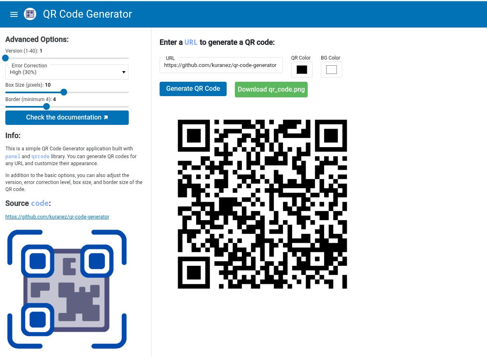

# QR Code Generator

<p align="left">
  <a href="https://www.python.org/" target="_blank">
    
  </a>
  <a href="https://pypi.org/project/qrcode/" target="_blank">
    
  </a>
  <a href="https://panel.holoviz.org/" target="_blank">
    
  </a>
  <a href="https://docs.docker.com/" target="_blank">
    
  </a>
</p>


A web-based tool built with `panel` and `qrcode` library that allows users to generate customized QR codes from URLs, with options to set error correction, size, colors, and download the generated image.

---

## 🌐 WebApp 

> [](https://apps.kuracodez.space/qr-code-generator/app)
>
> **Try the interactive web app — create, customize, and download QR codes instantly, all in your browser.**


---

## Screenshot

> 

---

## ⚙️ Features

#### Core Features

🔸 Generate QR codes from any URL input.

🔸 Select error correction level (L, M, Q, H).

🔸 Choose foreground and background colors.

🔸 Preview QR code instantly.

🔸 Download QR code as PNG image.

#### Additional Features

🔸 Responsive web interface built with [Panel](https://panel.holoviz.org/index.html).

🔸 Comprehensive documentation including examples for working in [Jupyter](https://jupyter.org/) Notebooks.


---

## 📦 Python Packages


**This script utilizes the following Python packages:**

> 🔸 `qrcode`: Used to generate QR codes from user-provided URLs with customizable options.
> 
> 🔸 `panel`: Provides the interactive web interface for user input, QR code preview, and download functionality.

**Please ensure these packages are installed in your environment to enable full functionality of the code.**

---

## 📁 File Structure

```yaml
qr-code-generator/
|
├── app.py              # WebApp
├── requirements.txt    # Install requirements
├── assets/             # Logos
├── docs/               # Documentation & Help
|
├── Dockerfile          # Docker files
├── docker-compose.yml
├── docker-compose.debug.yml
|
└── README.md
```

---

## ❓ How 2 Use

### 1. Install & Run Locally

```bash
# Clone the repository
git clone https://github.com/kuranez/qr-code-generator.git
cd qr-code-generator

# Install dependencies
pip install -r requirements.txt
```
**Option A: Run using Python** 
```python
python app.py
```

**Option B: Run using Panel**
```python
panel serve app.py --port 5010
```

> **🢅 Visit [http://localhost:5010](http://localhost:5010) in your browser.**


### 2. Run with Docker

```bash
# Build the Docker image
docker build -t qr-code-generator .

# Run the container
docker run -p 5010:5010 qr-code-generator
```

> **🢅 Open [http://localhost:5010](http://localhost:5010) to use the app.**

---

## 📙 Documentation

**Visit the [Project Documentation Page](./docs/documentation.md) for more info.** 


## 📕 Resources


> - [Holoviz Panel](https://panel.holoviz.org/) - A powerful Python framework for creating interactive web apps and dashboards, including the UI for this app.
> - [`qrcode` library on PyPI](https://pypi.org/project/qrcode/) - A pure Python library to generate QR codes. Used to create and customize QR images from any input.
> - [Docker Documentation](https://docs.docker.com/) -  Official guides for containerizing, deploying, and running this app consistently across different environments.


## 📘 License

This project is open source and available under the **MIT License**. 
You may modify, distribute, and use it freely in your own projects.

---
